# CSC258 — Magical Drop

A recreation of the arcade game *Magical Drop* using MIPS Assembly and the Saturn simulator.

## Milestone 1

- 7×14 playing field
- Four randomly generated bubble colours
- Player character
- Game board stored in memory

### Randomized Starting Board

Each time the program runs, the starting bubbles are randomly generated using four colours.

<table>
  <tr>
    <td></td>
    <td></td>
  </tr>
</table>

### Memory Layout

The 7×14 grid is stored as 98 words (392 bytes), with each cell represented by a number from 0–4.

- `0` = Empty
- `1` = Red
- `2` = Green
- `3` = Blue
- `4` = Yellow

The first 35 cells contain random colour values (1–4), while the remaining 63 are empty (0).

## Milestone 2

- Player movement using A and D
- Grabbing connected same-coloured bubbles using S
- Holding multiple bubbles while moving
- New row of random bubbles every 10 keypresses
- Regular screen refreshing
- Game over when bubbles reach the bottom row
- Press Q to quit

### Gameplay

<table>
  <tr>
    <td align="center">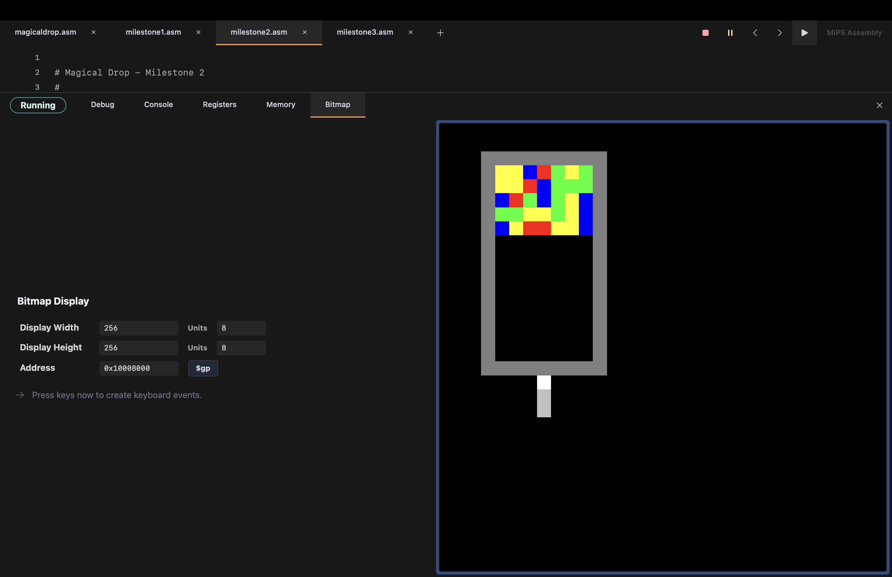 Starting board</td>
    <td align="center"> Grabbing bubbles</td>
  </tr>
  <tr>
    <td align="center">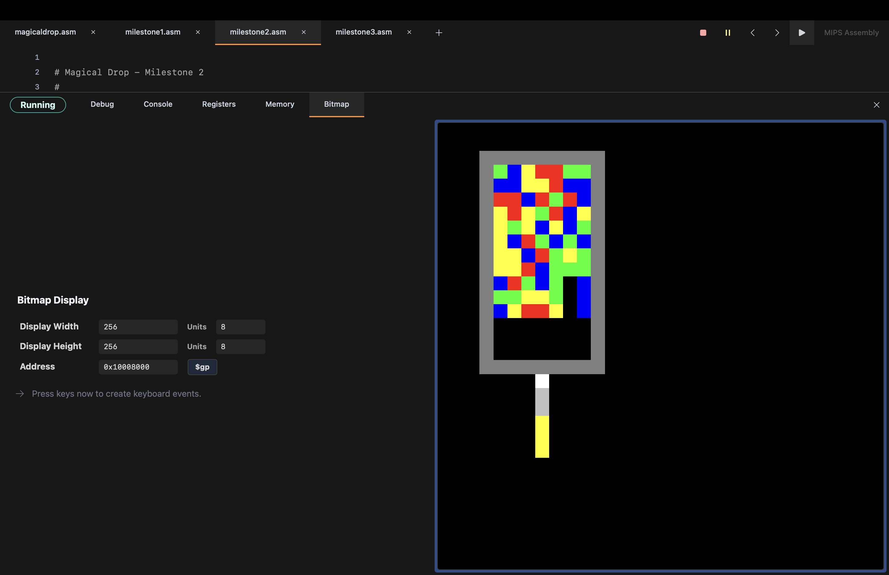 Row advancement</td>
    <td align="center"> Game over</td>
  </tr>
</table>

### Controls

| Key | Action |
|-----|--------|
| A | Move left |
| D | Move right |
| S | Grab same-coloured bubbles |
| Q | Quit game |

## Milestone 3

- Throwing held bubbles using W
- Removal of vertical matches of three or more same-coloured bubbles
- Unmatched bubbles remain on the board
- Game-over detection after throwing

### Gameplay

<table>
  <tr>
    <td align="center">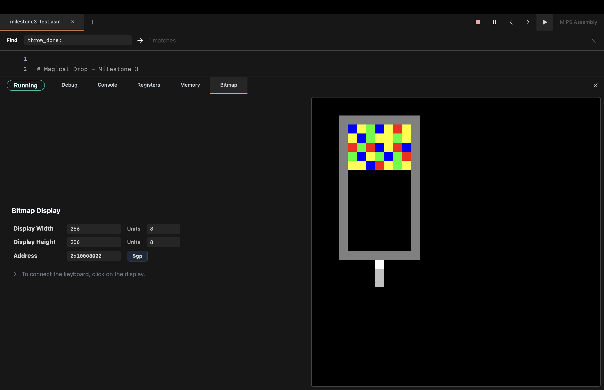 Starting board</td>
    <td align="center"> Before matching</td>
  </tr>
  <tr>
    <td align="center">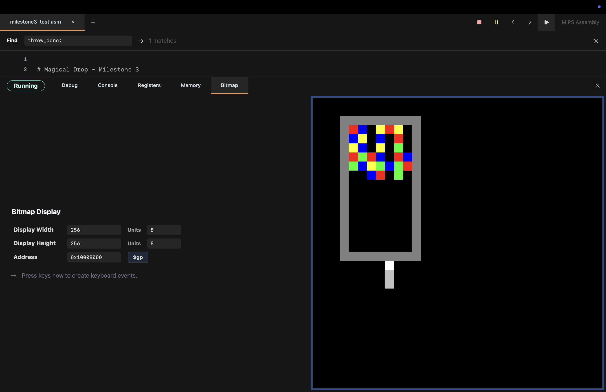 After matching</td>    
    <td align="center"> Throw without a match</td>
  </tr>
</table>

## Milestone 4 – Additional Game Features

### E1 – Automatic Row Advancement

- New rows are automatically generated based on elapsed time rather than the number of keypresses.
- Existing bubbles shift down and a new randomly coloured row appears at the top.
- The initial interval between rows is 5 seconds.

### E2 – Increasing Speed

- The time between new rows decreases by 250 milliseconds after each advancement.
- The minimum interval is 1500 milliseconds.
- The game becomes progressively more challenging as time passes.

### H3 – Upward Gravity

- Unsupported bubbles move upwards after matches are removed.
- Gaps within columns are eliminated while preserving the original order of the remaining bubbles.

### H4 – Validated Random Colour Generation

- The starting board and newly generated rows cannot introduce vertical matches of three or more bubbles.
- A randomly generated colour is rejected if it would complete a vertical match.

<table>
  <tr>
    <td align="center">
      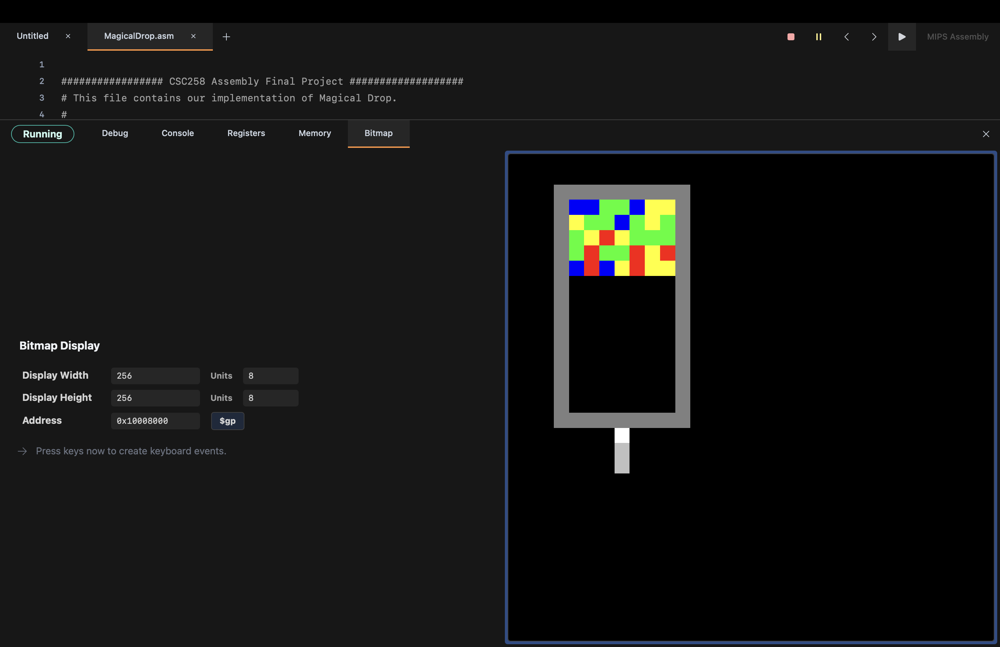 
      Starting board
    </td>
    <td align="center">
      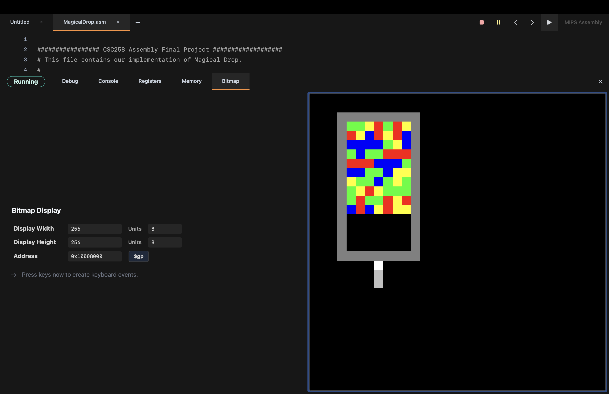 
      Automatic row advancement
    </td>
  </tr>
  <tr>
    <td align="center">
      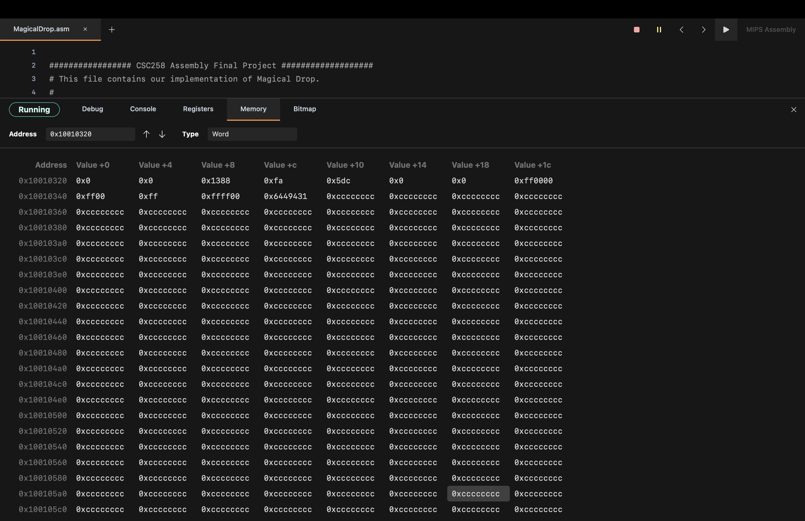 
      Initial interval: 5000 ms (0x1388)
    </td>
    <td align="center">
      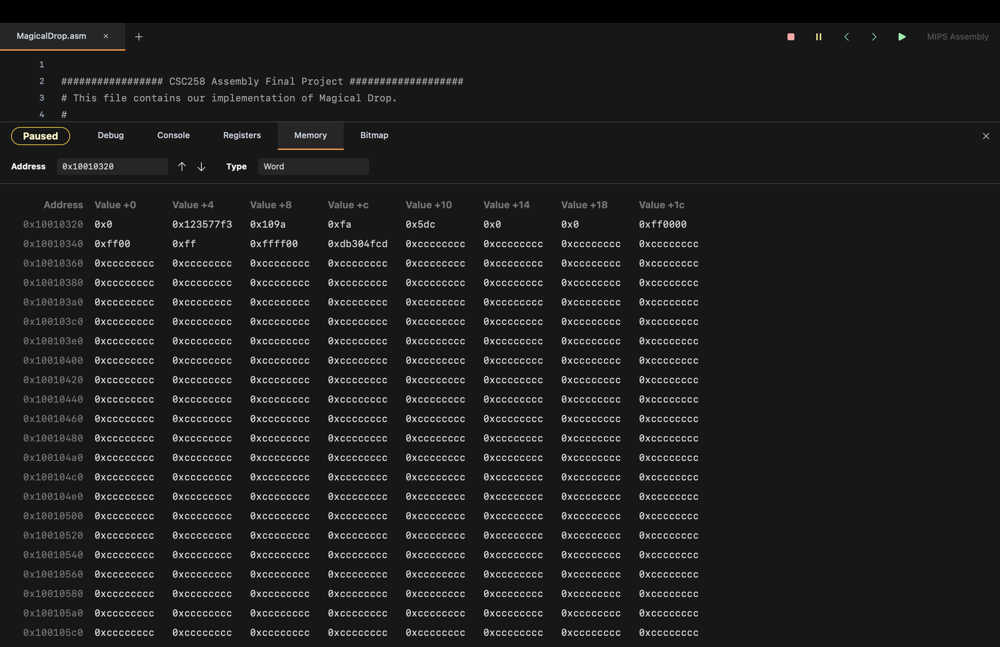 
      Reduced interval: 4250 ms (0x109a)
    </td>
  </tr>
</table>

## Milestone 5 – Flood Fill and Chain Reactions

### H2 – Flood Fill

- A vertical match of three or more bubbles triggers flood fill.
- All horizontally or vertically connected bubbles of the same colour are removed.
- Diagonal contact alone does not count as a connection.
- Upward gravity fills the gaps left by removed bubbles.

### H5 – Chain Reactions

- Gravity can bring additional bubbles of the same colour together.
- Newly formed vertical matches are automatically detected and removed.
- Matching, flood fill and gravity repeat until the board is stable.
- No additional player input is needed to trigger subsequent matches.

<table>
  <tr>
    <td align="center">
      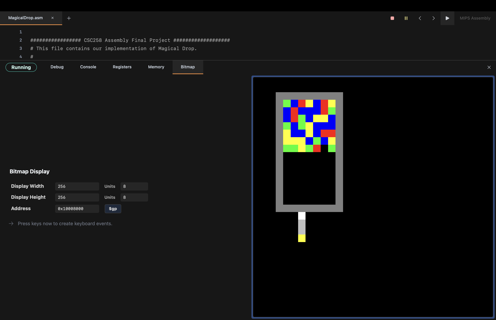 
      Before flood fill
    </td>
    <td align="center">
      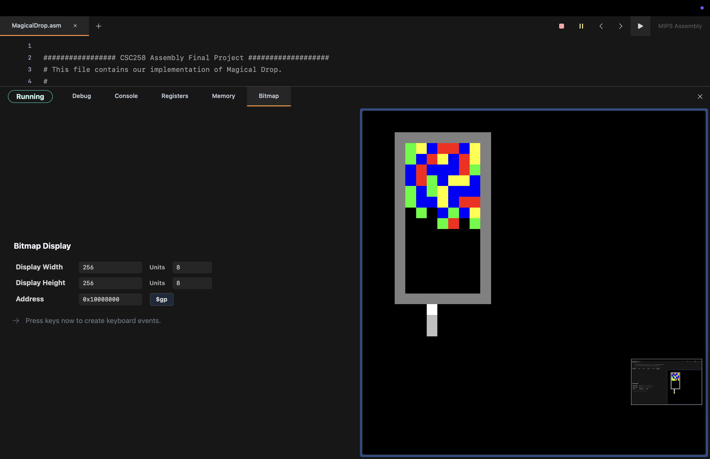 
      After flood fill and gravity
    </td>
  </tr>
  <tr>
    <td align="center">
      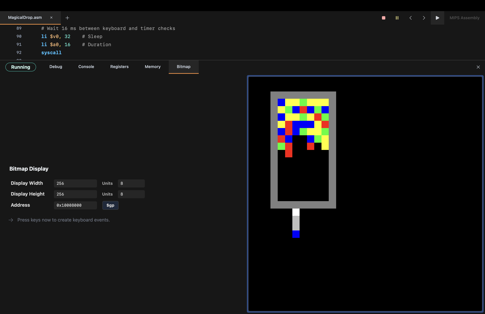 
      Before chain reaction
    </td>
    <td align="center">
      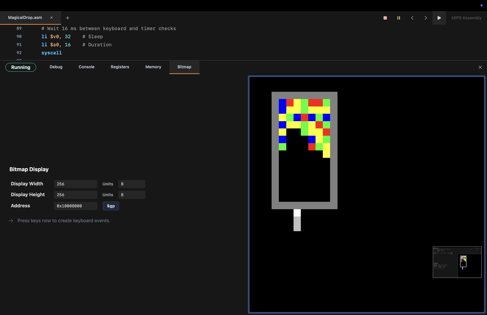 
      After chain reaction
    </td>
  </tr>
</table>

## Final Implementation

The final version is contained in `MagicalDrop.asm` and includes Milestones 1–5, with two additional easy features (E1, E2) and four hard features (H2, H3, H4, H5).

All implemented gameplay features have been tested in Saturn.
