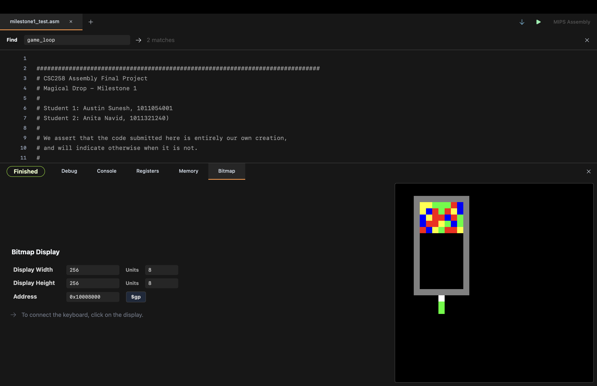
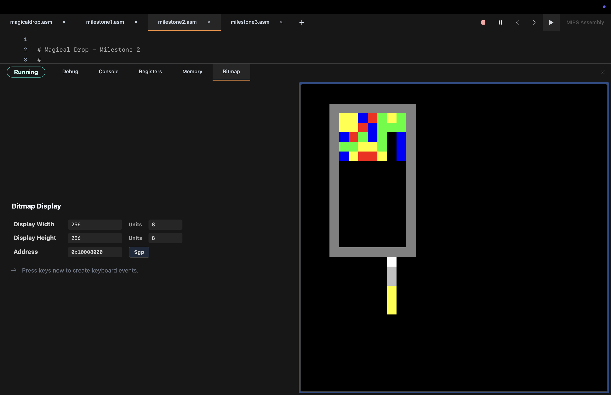
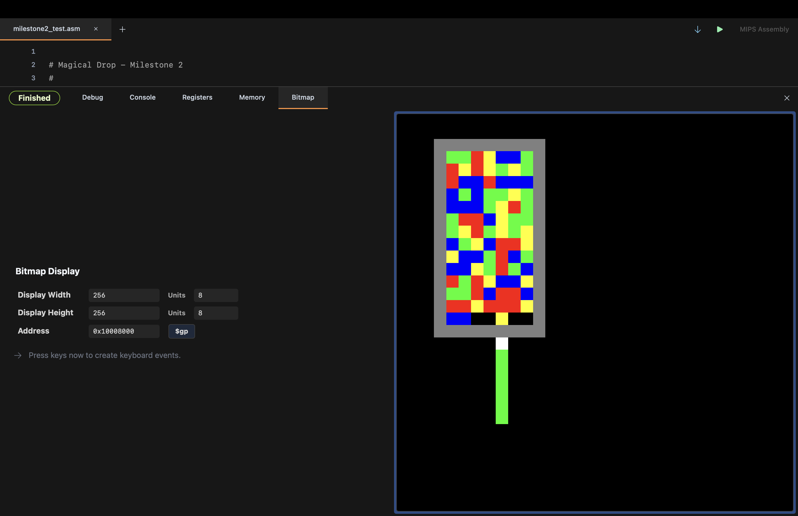
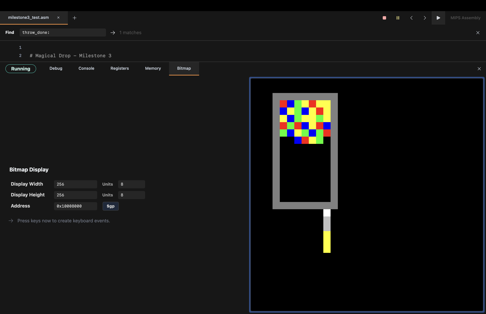
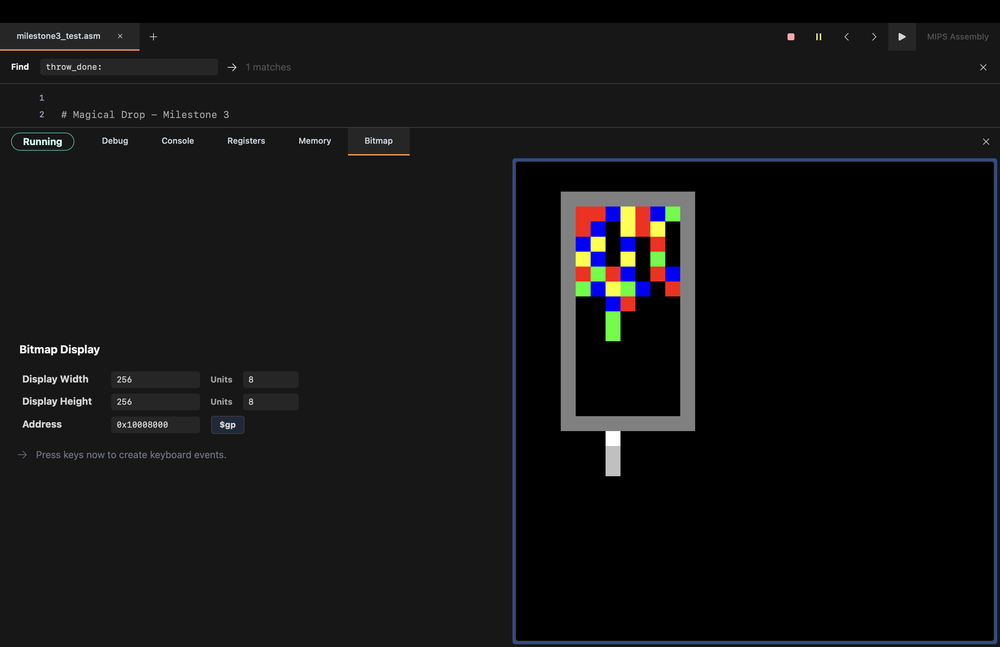

# CSC258 — Magical Drop

A recreation of the arcade game *Magical Drop* using MIPS Assembly and the Saturn simulator.

## Milestone 1

- 7×14 playing field
- Four randomly generated bubble colours
- Player character
- Game board stored in memory

### Randomized Starting Board

Each time the program runs, the starting bubbles are randomly generated using four colours.

<table>
  <tr>
    <td></td>
    <td></td>
  </tr>
  <tr>
    <td></td>
    <td></td>
  </tr>
</table>

### Memory Layout

The 7×14 grid is stored as 98 words (392 bytes), with each cell represented by a number from 0–4.

- `0` = Empty
- `1` = Red
- `2` = Green
- `3` = Blue
- `4` = Yellow

The first 35 cells contain random colour values (1–4), while the remaining 63 are empty (0).

## Milestone 2

- Player movement using A and D
- Grabbing connected same-coloured bubbles using S
- Holding multiple bubbles while moving
- New row of random bubbles every 10 keypresses
- Regular screen refreshing
- Game over when bubbles reach the bottom row
- Press Q to quit

### Gameplay

<table>
  <tr>
    <td align="center"> Starting board</td>
    <td align="center"> Grabbing bubbles</td>
  </tr>
  <tr>
    <td align="center"> Row advancement</td>
    <td align="center"> Game over</td>
  </tr>
</table>

### Controls

| Key | Action |
|-----|--------|
| A | Move left |
| D | Move right |
| S | Grab same-coloured bubbles |
| Q | Quit game |

## Milestone 3

- Throwing held bubbles using W
- Removal of vertical matches of three or more same-coloured bubbles
- Unmatched bubbles remain on the board
- Game-over detection after throwing
- Updated player colour to grey

### Gameplay

<table>
  <tr>
    <td align="center"> Starting board</td>
    <td align="center"> Before matching</td>
  </tr>
  <tr>
    <td align="center"> After matching</td>    
    <td align="center"> Throw without a match</td>
  </tr>
</table>
