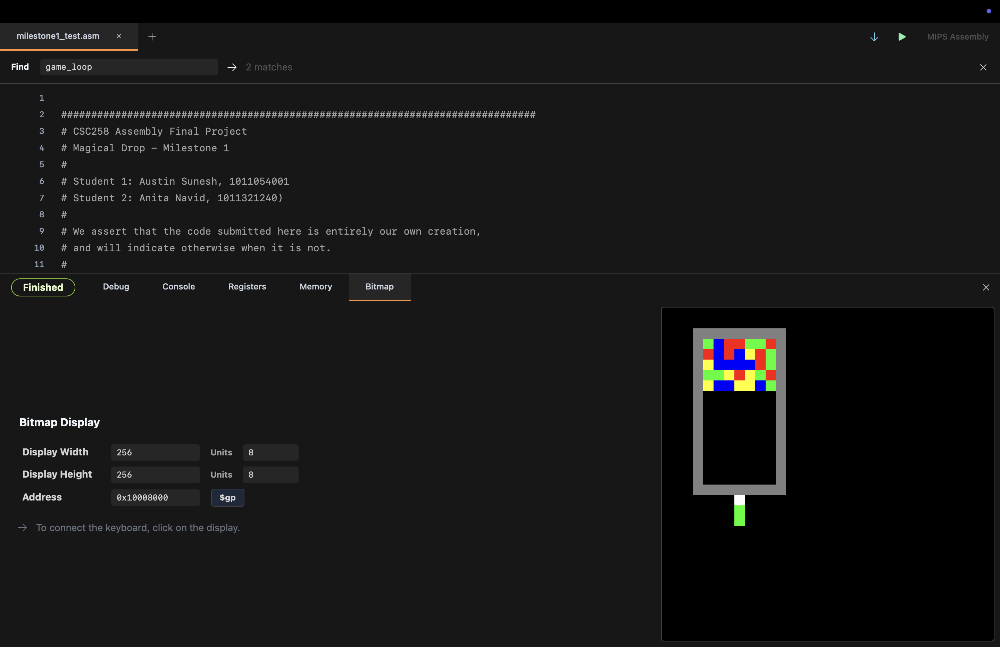
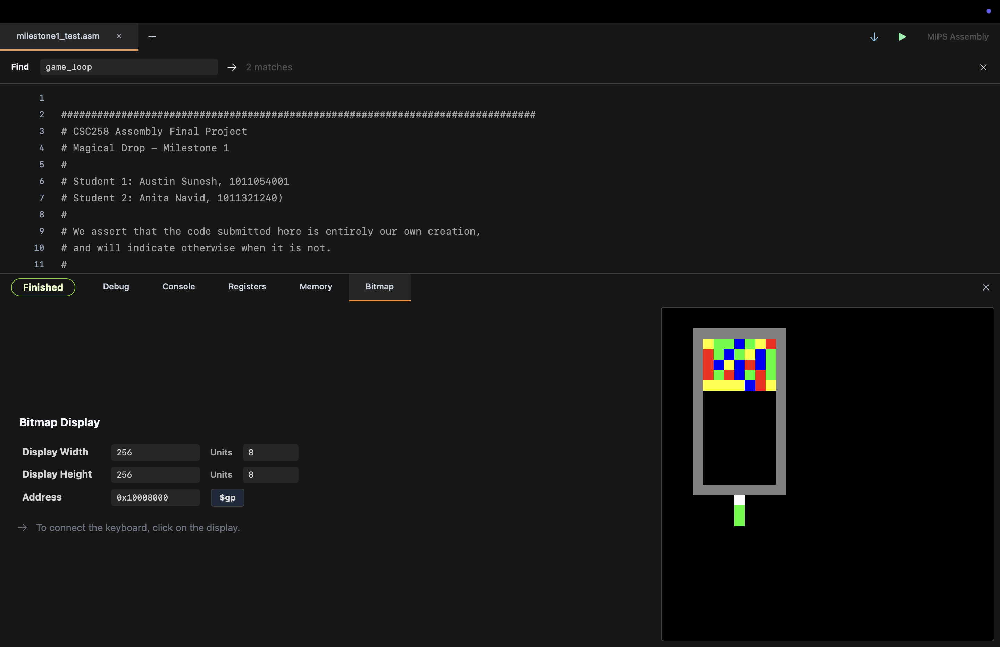
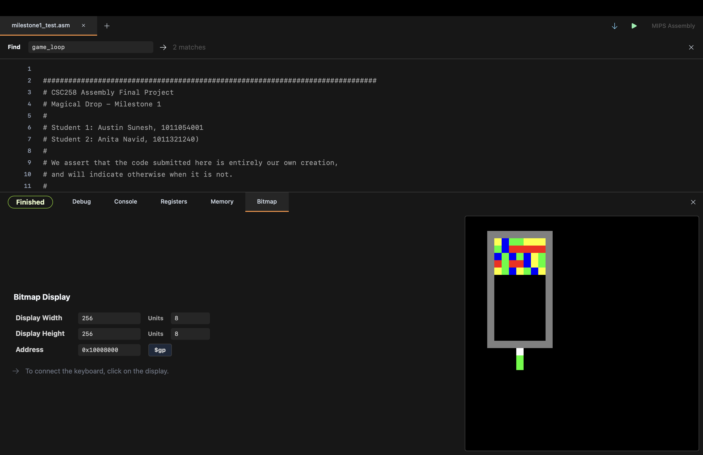
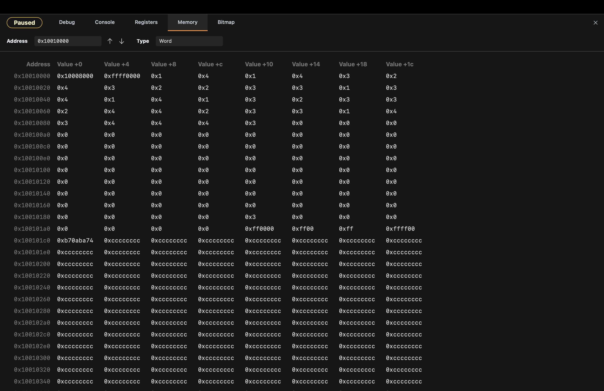

# CSC258 — Magical Drop

A recreation of the arcade game *Magical Drop* using MIPS Assembly and the Saturn simulator.

## Milestone 1

- 7×14 playing field
- Four randomly generated bubble colours
- Player character
- Game board stored in memory

### Randomized Starting Board

Each time the program runs, the starting bubbles are randomly generated using four colours.

<table>
  <tr>
    <td></td>
    <td></td>
  </tr>
  <tr>
    <td></td>
    <td></td>
  </tr>
</table>

### Memory Layout

The 7×14 grid is stored as 98 words (392 bytes), with each cell represented by a number from 0–4.

- `0` = Empty
- `1` = Red
- `2` = Green
- `3` = Blue
- `4` = Yellow

The first 35 cells contain random colour values (1–4), while the remaining 63 are empty (0).

